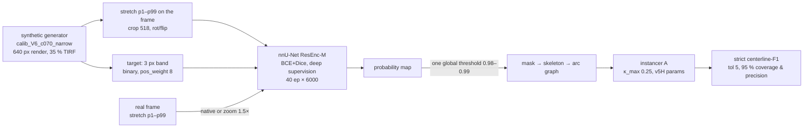

# Audit of the current best method (SPARSE35 → instancer A): weaknesses, evidence, plan

Date: 2026-09-04. Status: diagnosis complete; four training arms and one decoder screen are running
on tulen and are marked **pending** below. Every number is on roi303 VAL (141 frames, unrepaired
block, native inference unless stated); nothing here has touched TEST. Companion documents: the
three literature reports of the same date (`2026-09-04-thin-filament-continuity.md`,
`2026-09-04-junctions-and-crossings.md`, `2026-09-04-parallels-preprocessing-domain-gap.md`), the
scale-and-gap audit (`2026-09-02-scale-and-gap-audit.md`), and the pre-registered protocol in
`docs/TODO.md §0.0-CAMPAIGN`.

## 0. Summary

The pipeline is a synthetic-only-trained nnU-Net ResEnc-M binary segmenter (SPARSE35) whose
probability map is thresholded once, globally, and handed to the curvature-bounded instancer A.
With an oracle mask the instancer scores 0.95 strict F1; with the model's mask it scores 0.50–0.52.
**The whole gap is in the mask.** Within the mask, the loss is not where the project assumed:

- Crossings are lost because one **arm is too weak to survive the threshold**, not because the
  junction geometry is hard. 97.6 % of failed GT crossings have a *disconnected* mask at the crossing;
  62 % have an arm missing outright; the instancer resolves 79 % of crossings on the oracle mask.
- The right threshold is a **per-frame** quantity (10th–90th percentile 0.70–0.997, full range
  0.30–0.9995) and **no image covariate predicts it** (|Spearman ρ| ≤ 0.24). An oracle per-frame
  threshold is worth +0.048 mean F1 on frames with ≥ 10 GT. The network's *confidence* is
  miscalibrated per frame, and the covariates that move confidence are density, SNR, bright-share,
  FWHM and grey-level count — all training-distribution levers.
- The training target (3 px band, BCE + Dice) makes the map a **step, not a peak**; the arms that
  fail sit on the falling edge of that step. Plain ridge NMS on the map is worse than thresholding
  (spurs on the saturated plateau), so the fix is on the training side (a peaked target) or a
  decoder that uses the valley between ridges, not the ridge itself.

Where that leaves the plan: three data/target levers (photometric augmentation, scale augmentation,
denser generator prior) plus one target lever (existence + Gaussian heat head) are running as
attributable A/B arms against SPARSE35; the decoder screen (valley cut, hysteresis) is the only
inference-side item. The benchmark itself was repaired (5 degenerate frames, 35 duplicate polylines).

## 1. The pipeline as it stands

Numbers that anchor the audit:

| quantity | value | source |
|---|---|---|
| SPARSE35, roi303 VAL 141, best swept threshold | 0.500 (1.5×) / 0.520 (native), p = 0.23 | `runs/scale/thr_SPARSE35*.json` |
| oracle mask + tuned instancer | 0.951 | 0.0-MASK |
| GT never found at any threshold | 13 % | scale-and-gap audit |
| width of the p > 0.99 band on isolated real filaments | 2.08 px | scale-and-gap audit §A.4 |
| real filament FWHM native / 1.5× vs synth native | 3.51 / 5.51 vs 4.03–4.81 px | scale-and-gap audit §A |
| 2×2 factorial THIN / PRIOR_THIN / PRIOR_THICK | null to negative in every cell | 0.0-CAMPAIGN |

## 2. Weaknesses by stage

### 2.1 Preprocessing and normalisation

What happens: the synthetic frame is stretched to its own [1, 99] percentiles at 640 px, then
cropped to 518 px; the real frame is stretched to *its* [1, 99] percentiles at full size, then
either fed at native scale or zoomed 1.5× (bilinear) before inference. No photometric, scale,
blur or quantisation augmentation existed until today. Weaknesses, with the evidence:

1. **Scale mismatch.** Real filaments are 3.51 px FWHM at native and 5.51 px at 1.5×; the synthetic
   ones are 4.03–4.81 px. The model was trained on one width and tested on another in both
   directions. Native inference beats 1.5× by +0.02–0.05 in every factorial cell — the first
   consistent effect the campaign found, and it is a preprocessing effect.
2. **Per-frame confidence tracks image statistics.** The 25th percentile of the probability under
   the GT centerlines (how confident the model is on its *weak* stretches) correlates with:

   | covariate | Spearman ρ (p) | direction |
   |---|---|---|
   | bright share (fraction of bright-polarity filament) | +0.62 (5e-13) | brighter frames → more confident |
   | curves per Mpx | −0.59 (2e-11) | denser → less confident |
   | filament FWHM | −0.59 (3e-11) | wider → less confident |
   | SNR | +0.59 (1e-11) | noisier → less confident |
   | grey levels between p1 and p99 | +0.46 (7e-7) | coarser quantisation → less confident |

   Every one of these is a distribution the generator or the augmentation controls. None of them
   predicts the *optimal threshold* (|ρ| ≤ 0.24), so the fix cannot be a threshold rule; it has to
   be training that makes confidence invariant to them.
3. **Two copies of the benchmark differ in bit depth.** The tulen block is built from raw TIFs
   (178/281 frames > 8 bit, some raw frames with only 16–50 grey levels between p1 and p99); the
   laptop copy is 8-bit exports. All campaign numbers are on the raw block. Quantisation is one of
   the covariates above, so this is not cosmetic.
4. **Normalisation granularity is inconsistent** between the 640 px synthetic frame, the 518 px crop
   (the new photometric augmentation re-stretches the crop), and the full real frame. Recorded as an
   attribution caveat for the AUG_PHOTO read (TODO 0.0-CAMPAIGN).

5. **The checkpoint is SELECTED at a scale that neither training nor deployment uses (added
   2026-09-07, `scripts/diag_pick_scale.py`, diagnosis 30).** `train_v5.validate` upscales the
   real VAL frame 1.5× before the forward pass, so the gate that chooses which epoch ships ranks
   checkpoints at 1.5× — while the crops are trained at native scale and the campaign screens at
   native inference. Rescoring SPARSE35's ten saved checkpoints at both scales on the trainer's
   own 16 MT-34 VAL frames:

   | epoch | 004 | 008 | 012 | 016 | 020 | 024 | 028 | 032 | 036 | 040 |
   |---|---|---|---|---|---|---|---|---|---|---|
   | native | 0.364 | 0.420 | **0.442** | 0.420 | 0.423 | 0.432 | 0.438 | 0.439 | 0.434 | 0.439 |
   | 1.5× | 0.413 | 0.436 | 0.446 | 0.450 | 0.454 | 0.462 | 0.459 | 0.451 | **0.463** | 0.462 |

   The 1.5× argmax reproduces the trainer's own pick (ep36) exactly, so the rescoring is faithful.
   The native curve plateaus at ep12 and then moves ±0.008 for 28 epochs; the 1.5× curve keeps
   improving to ep36, while the foreground fraction falls monotonically at both scales. Late
   training buys precision that the strict metric can only see once the image is upscaled.
6. **The selection SET disagrees with the deployment set about scale (same diagnosis).** On the
   trainer's VAL (MT-34, 16 frames) 1.5× beats native by +0.02–0.03; on roi303 VAL (139 frames)
   native beats 1.5× by +0.02–0.05 (point 1 above). The two benchmarks differ in annotation
   provenance — MT-34's 585 half is 69 % model-drawn, roi303 is human-drawn — so "which scale is
   better" is partly a property of who drew the ground truth, not of the model. Any fix to the
   selection scale must therefore also state which benchmark the gate is allowed to see.

What was closed and must not be retried: CLAHE and elastic deformation (the parallels report), a
thinner target, 2-D hysteresis and closing as continuity fixes, TTA (the retrain-not-inference
rule), nnU-Net's noise-variance defaults verbatim.

### 2.2 Annotation processing

The roi303 block is the first *human-drawn* benchmark the project has (14 123 curves, 281 frames;
`scripts/build_roi_dataset.py`). Its ImageJ polylines were fragmented at dark stretches, debris and
crossings, so a join rule rejoins fragments only when the gap, the tangent agreement and the implied
curvature (κ_max) all pass. Defects found today and repaired (`scripts/repair_roi_dataset.py`):

- **5 frames whose image is empty or saturated but carry annotation** (VAL `roi_img_8` with 42
  curves on a black frame, `roi_img_149`; TEST `roi_img_139`, `roi_img_143`, `roi_img_148`). Each
  is a guaranteed false negative and, for `roi_img_8`, a tile-boundary artefact in the map.
- **35 duplicate polylines in 23 frames** (33 exact). Under one-to-one matching every duplicate is a
  guaranteed FN, and duplicates poison any close-parallel statistic below 2 px. The frames where
  even the oracle mask loses crossing identity are the duplicate frames.
- Repair: image gate (p1–p99 span ≥ 2 grey levels, ≥ 50 % of pixels above the frame minimum) plus a
  geometric dedupe (drop B iff ≥ 90 % of B lies within 1.5 px of a not-shorter A). The declared
  split is untouched. Applied to the laptop copy; the tulen block is repaired the moment the ridge
  screen releases the h5 files, and SPARSE35 is re-swept as the baseline on the repaired 139-frame
  VAL. Expected effect ≈ 0.005 mean F1.

Two facts about the annotation that bound what any model can reach: 13 % of GT is never found at
any threshold (synthetic contrast realism, not decoding), and the earlier agreement-bias
measurement (+0.20 to +0.28 on model-drawn vs human-drawn GT) is the reason roi303, not MT-34, is
now the tuning block.

### 2.3 The training target

A 3 px binary band, BCE with pos_weight 8 plus Dice, deep supervision with max-pooled targets. The
consequence, measured on real: the p > 0.99 band is 2.08 px wide on isolated filaments and the map
falls to 0.51 at 2 px and 0.18 at 3 px from the centerline. The network learns *inside/outside a
band*, so its value along a filament is a saturated plateau that **dips** wherever the evidence
weakens (a faint stretch, the second arm of a crossing, the gap between parallels). Those dips are
exactly where a global threshold cuts. The 2×2 factorial (thinner band, priors, thicker band) was
null-to-negative in every cell, which says the *width* of the band is not the lever; its *shape* is.

### 2.4 The decoder

One global threshold, swept per model on a 19-point grid, then skeleton → arc graph → instancer A.

- Per-frame optimal threshold (frames with ≥ 10 GT): 10th percentile 0.70, median 0.97, 90th 0.997,
  range 0.30–0.9995. Oracle per-frame threshold: +0.048 mean F1 (+0.035 GT-weighted).
- Plain ridge NMS on the map is **worse** than the threshold: the saturated plateau produces spurs
  (789 branch points vs 65 on `roi_img_119`). Written up as the reason the HEAT arm exists.
- The valley cut (low-threshold mask minus the valley pixels between two ridges) helps some frames
  and hurts others on the first 3 frames; the 141-frame paired screen (11 variants, Holm entry 14)
  is **pending**.

### 2.5 Crossings — the measured mechanism

1 083 GT crossings on the 141 VAL frames, mask at threshold 0.98, native inference:

| quantity | value |
|---|---|
| crossings whose two filaments keep identity through the instancer | 21.8 % |
| same on the oracle mask | 79.1 % |
| mask connected across the crossing | 17.3 % |
| of the 847 failures: mask disconnected at the crossing | 97.6 % |
| of the 847 failures: an arm missing from the mask | 62.1 % |
| of the 847 failures: oracle mask would have resolved it | 75.1 % |
| blob ratio (crossing blob vs. expected), median, resolved / failed | 1.00 / 0.49 |
| identity, same-polarity / opposite-polarity crossings | 23.3 % (n 973) / 8.2 % (n 110) |
| identity, shallow / oblique / steep angle | 36 % / 17 % / 15 % |

Reading: the crossing itself is confident (median p at the crossing 0.997); what fails is that one
arm's plateau has already fallen below the threshold before it reaches the crossing, so the mask
arrives with three arms or two. Angle does not rescue the geometric story — the *shallow* crossings,
the hardest for the instancer, are resolved most often. Opposite-polarity crossings (dark on bright)
fail three times as often, which is the interference zero-crossing the generator now renders
correctly (photometry fix of 2026-08-28) but still under-represents.

### 2.6 The generator's priors

- **Density.** The count prior is `density_center ± 6` = 2–14 microtubules per 640 px render
  (≈ 5–34 per Mpx; `scripts/gen_train.py build_cfg` with `calib_V6`'s `density_center 8`, before
  the length-coupled count shift), while the real VAL frames sit at a median of 24.5 and a 90th
  percentile of 87 curves per Mpx on the 108 frames with ≥ 10 GT (all 141: median 17, 90th
  percentile 79, maximum 140). Density is the strongest negative covariate of confidence
  (§2.1); the model has rarely seen the frames it is least confident on.
- **Photometrics.** Grey-level count, SNR and bright share all move confidence; the generator draws
  them from fitted but narrow distributions, and the biased-corpus rule says to *randomise wide*, not
  to fit them tighter.
- **Scale.** No scale randomisation at all; §2.1 item 1.

## 3. The plan, as pre-registered

Each arm differs from SPARSE35 by exactly one flag set (`scripts/run_arm.sh`), is swept per model at
both scales on the repaired 139-frame VAL, and is judged by paired bootstrap against the repaired
SPARSE35 baseline with Holm over the whole campaign family (entries 1–22). Promotion needs Holm
p < 0.05 on mean F1 with micro F1 not lower, plus its mechanism check.

| arm | what changes | attacks | mechanism check | status |
|---|---|---|---|---|
| ridge / valley decoder (14) | mask = low threshold minus the valley between two ridges; hysteresis variants | fusion at low thresholds | junction identity and bundle recovery reported with F1 | screen running, 2 of 8 chunks done |
| AUG_PHOTO (15/16) | illumination field, gamma, contrast, blur, noise, quantisation to 2^U(4,8) levels on the rendered frame | per-frame confidence vs SNR / grey levels / bright share | per-frame optimal-threshold spread must NARROW; weak-arm fraction must fall | training, epoch 6/40 |
| SCALE (17/18) | zoom U(0.8, 1.5) of frame and polylines before rasterising, target stays 3 px, low-res simulation | FWHM mismatch | the absolute native-vs-1.5× F1 difference must fall below 0.01 | queued |
| HEAT (19/20) | second head regressing a Gaussian centerline heatmap (σ 1.2 px), decoded by NMS gated on existence | step-not-peak; spurs of plain NMS | branch-point count per frame next to F1; G/GU variants declared | queued |
| DENSE (21/22) | count prior widened to 4–60 per render (10–146 per Mpx) | density covariate | confidence on dense frames; identity on same-polarity crossings | queued |

Follow-ups that stay declared but unbuilt until the arms are read: crossing-region weighting or a
multiplicity (0 / 1 / ≥ 2) class, a path-connectivity loss on the heat head, an orientation head for
the decoder's normals. Any new best needs ≥ 3 seeds before it is called; TEST is exposed once, at
the end of the campaign.

## 4. What the audit rules out

- Tuning the instancer further (oracle 0.95; the instancer resolves 79 % of crossings on a clean mask).
- Any per-frame threshold rule from image statistics (no covariate predicts the optimum).
- Plain NMS on the existing map, 2-D hysteresis, morphological closing, thinner targets, TTA.
- Fitting the generator's morphology or density to the real corpus by moment matching (the biased-
  corpus rule); the density prior is *widened*, not fitted.
